<div align="center">

# NYMIX TECH

### A multi-portal business management platform for Kenyan SMEs, with a built-in AI-assisted Security Operations Centre


**Built by [Nym Kiprop](https://www.linkedin.com/in/nym-kiprop-b5156a3a5)**, founder of NYMIX TECH · KCA University · Kenya

[LinkedIn](https://www.linkedin.com/in/nym-kiprop-b5156a3a5)

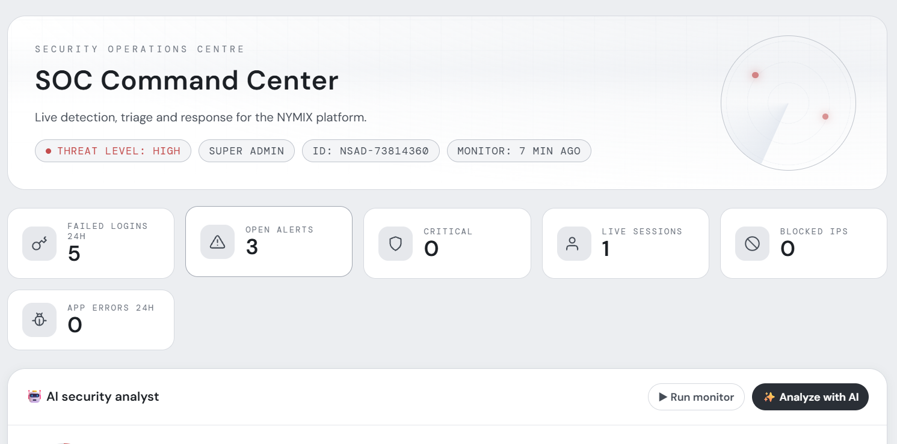

</div>

---

## Table of contents

1. [The story](#the-story)
2. [At a glance](#at-a-glance)
3. [Product tour](#product-tour)
4. [The four portals](#the-four-portals)
5. [Security Operations Centre](#security-operations-centre-soc)
6. [AI layer](#ai-layer)
7. [Payments and compliance](#payments-and-compliance)
8. [Database](#database)
9. [Architecture](#architecture)
10. [Tech stack](#tech-stack)
11. [Project structure](#project-structure)
12. [Getting started](#getting-started-local-xampp)
13. [Security notes](#security-notes)
14. [What I learned](#what-i-learned)
15. [Roadmap](#roadmap)
16. [Author](#author)

---

## The story

Most small businesses in Kenya run on paper, WhatsApp and memory. NYMIX gives a hardware store, wholesaler, supermarket, agrovet, pharmacy or electronics shop **one system** for sales, stock, staff, salaries, subscriptions and customer support, with **M-Pesa and card payments** built in.

Over several months I also kept studying **IDS and SIEM tools**. At some point I asked myself why I was only reading about them when I had a real system sitting right here. So I kept it simple and built the core idea into NYMIX: collect everything the platform sees, watch for things that look wrong, show it in one place, and have an AI tell me what to do about it.

The result is a SOC that lives inside the product: a request-level IDS/IPS (**Shield**), an anti-malware and file-integrity engine, a security posture scorer, a live SOC dashboard, an **AI security analyst**, **AI-written PDF security reports**, and a **safe attack simulator** that runs a fake attacker through the real detection and blocking pipeline.

---

## At a glance

| | |
|---|---|
| **Portals** | 4 (Staff/POS, Client, Warehouse, Super Admin) |
| **Database** | 122 tables and 5 reporting views |
| **Code** | About 43,000 lines of PHP |
| **Business types supported** | Hardware, wholesale, supermarket, agrovet, pharmacy, electronics |
| **Payment providers** | M-Pesa (Daraja), Paystack, Pesapal, IntaSend |
| **Tax compliance** | KRA eTIMS submission queue with failure alerts |
| **AI in the product** | Branch Insights, accounts-under-review explanations, recruitment screening, support auto-replies, in-portal assistant |
| **Staff engagement** | XP levels from sales, hours and stock actions |
| **Security posture checks** | 30+ automatic checks, scored 0-100 |
| **Shield detection** | Recon, scanner, SQLi, XSS, traversal, LFI, command injection, Log4Shell, Shellshock, floods |
| **AI providers** | Groq, then Gemini, then OpenRouter (automatic fallback) |

---

## Product tour

A walk through the real product. All data in these screenshots is demo data for a fictional client, **Savannah Hardware & Supplies**.

### Client Portal (the business owner's view)

<table>
<tr>
<td width="50%">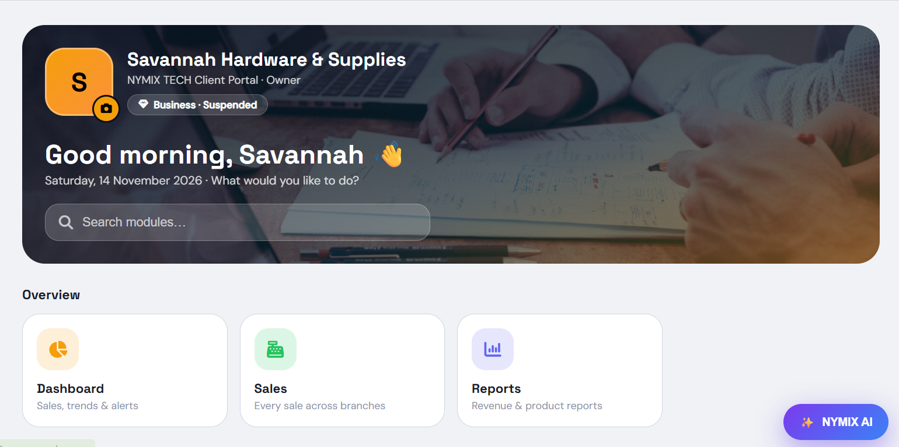<br><sub><b>Home: module launcher with search</b></sub></td>
<td width="50%">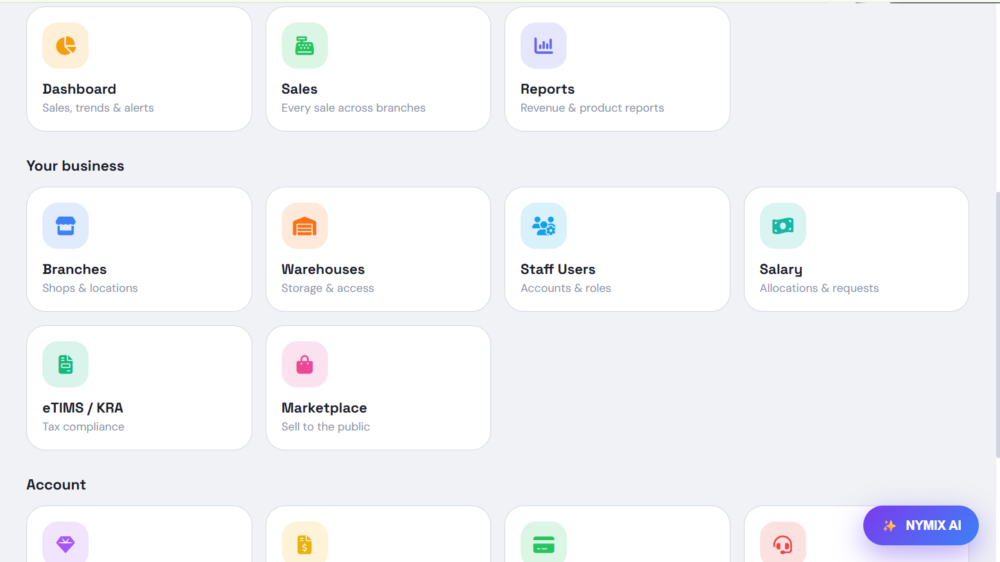<br><sub><b>Every module as a card: branches, warehouses, staff, salary, eTIMS, marketplace</b></sub></td>
</tr>
</table>
<p align="center">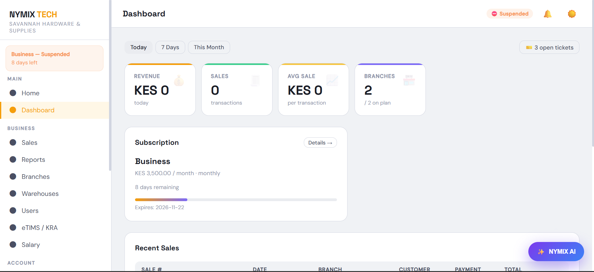<br><sub><b>Dashboard: revenue, sales, average sale, branches, subscription status and open tickets</b></sub></p>
<p align="center">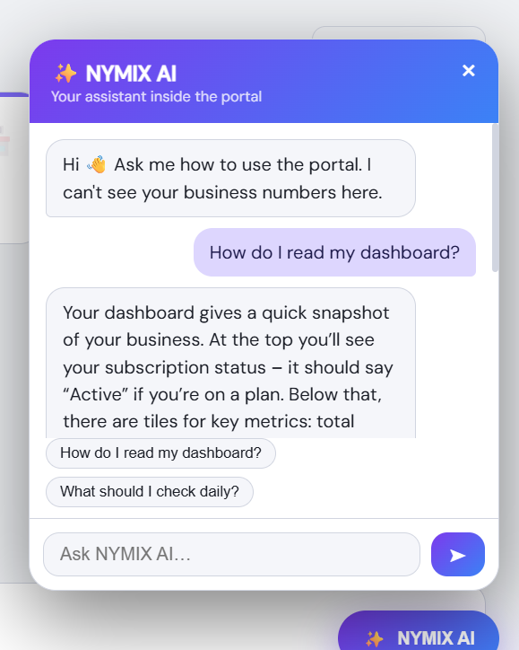<br><sub><b>NYMIX AI inside the portal: it answers "how do I..." questions and says up front that it cannot see business numbers</b></sub></p>

### Staff Portal (branch manager and staff view)

<p align="center">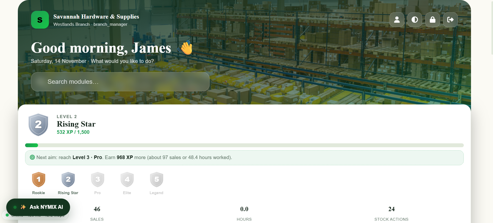<br><sub><b>Staff home: personal greeting, XP level (Rookie to Legend) and activity stats (sales, hours, stock actions)</b></sub></p>
<table>
<tr>
<td width="50%">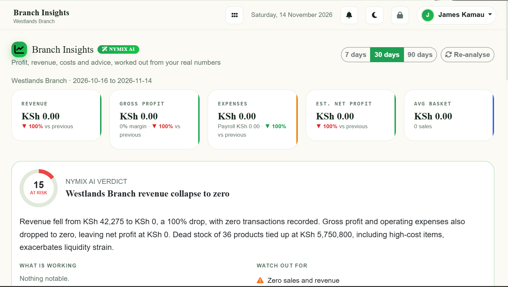<br><sub><b>Branch Insights (30 days): KPIs plus an AI verdict and risk score</b></sub></td>
<td width="50%">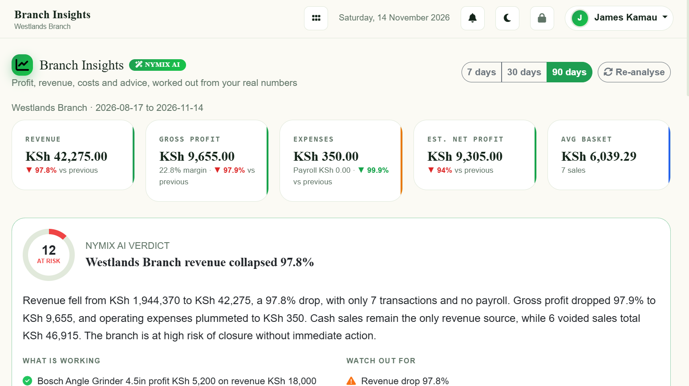<br><sub><b>Branch Insights (90 days): same branch over a longer window, with what is working and what to watch</b></sub></td>
</tr>
</table>
<table>
<tr>
<td width="50%">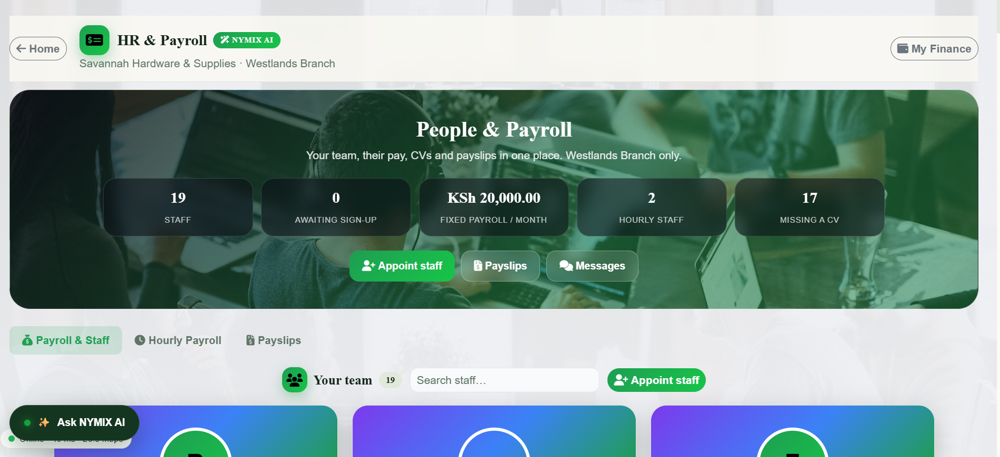<br><sub><b>HR and Payroll: staff, fixed and hourly pay, CV tracking, payslips</b></sub></td>
<td width="50%">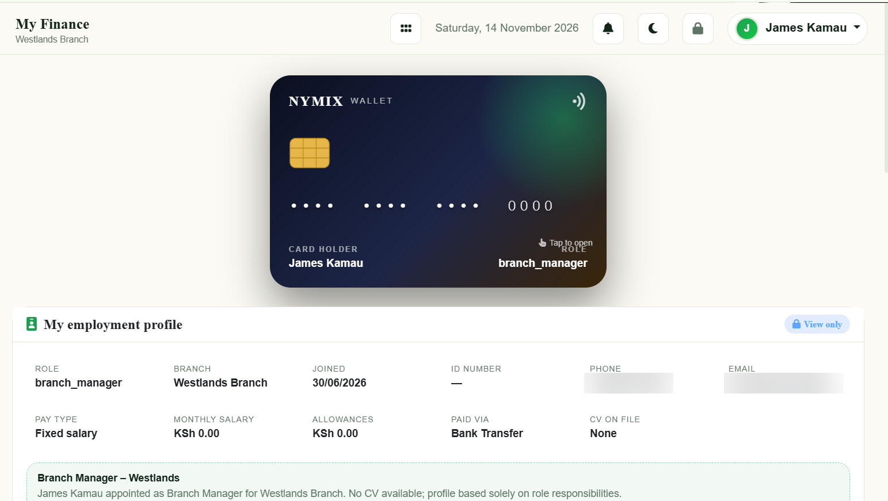<br><sub><b>My Finance: wallet card and read-only employment profile</b></sub></td>
</tr>
</table>
<table>
<tr>
<td width="50%">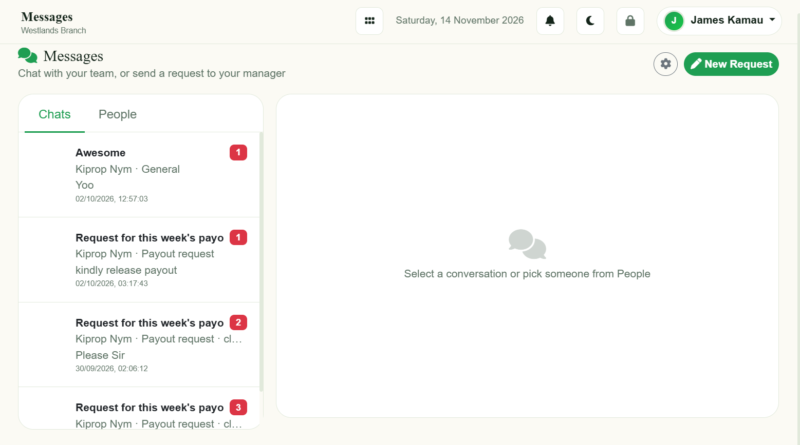<br><sub><b>Messages: team chats and requests to the manager (for example payout requests)</b></sub></td>
<td width="50%">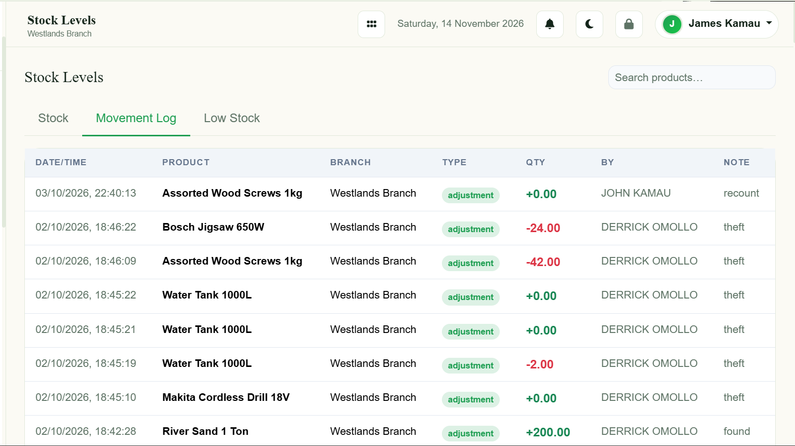<br><sub><b>Stock movement log with types, quantities, who and why</b></sub></td>
</tr>
</table>
<table>
<tr>
<td width="50%">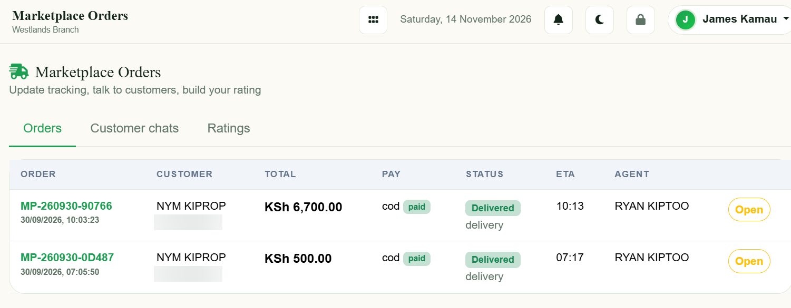<br><sub><b>Marketplace orders: tracking, delivery agent, customer chats and ratings</b></sub></td>
<td width="50%">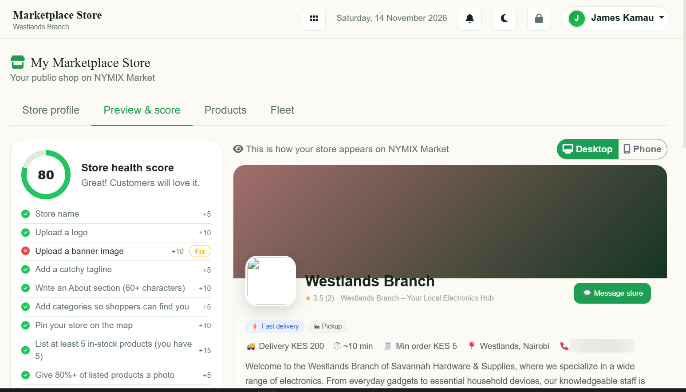<br><sub><b>Marketplace store: health score, live preview (desktop and phone), products and fleet</b></sub></td>
</tr>
</table>
<table>
<tr>
<td width="50%">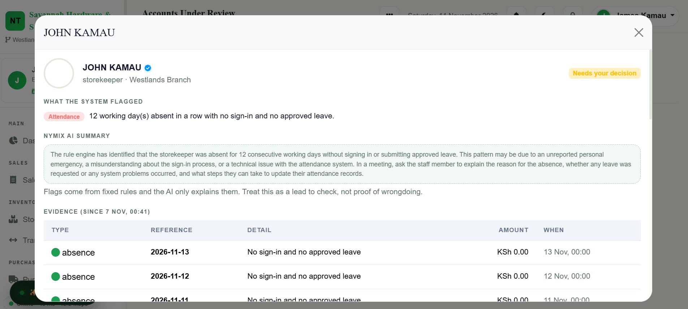<br><sub><b>Accounts Under Review: rule-based flag with an AI explanation and evidence</b></sub></td>
<td width="50%">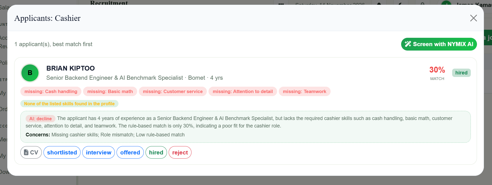<br><sub><b>Recruitment: applicants ranked by match, AI screening and a hiring pipeline</b></sub></td>
</tr>
</table>

### Security Operations Centre (Super Admin view)

See the [SOC section](#security-operations-centre-soc) below for the Command Center, AI analyst, Shield and PDF reports.

---

## The four portals

One codebase, four separate portals, each for a different kind of user.

| Portal | Entry file | Users | Purpose |
|---|---|---|---|
| **Staff / POS Portal** | `staff_portal.php` | Cashiers, managers, HR | Point of sale, inventory, staff, salaries, messaging |
| **Client Portal** | `client_portal.php` | Business owners (paying clients) | Sign-up, onboarding, subscription, branches, sales overview |
| **Warehouse Portal** | `warehouse.php` | Warehouse teams | Full warehouse management (WMS) |
| **Super Admin Portal** | `admin/dashboard.php` | Platform owner and admins | Clients, billing, support, SOC and security |

### Staff / POS Portal

The biggest portal (about 18,500 lines). Sections include:

- **POS and sales:** multi-branch point of sale, sales history, receipts with signed QR codes
- **Inventory:** products, categories, units, stock levels, stock movements, branch-to-branch transfers, low-stock notifications
- **Purchasing:** suppliers, purchase orders, supplier payments
- **Customers and finance:** customer records and payments, expenses and expense categories, finance overview, reports, AI insights
- **People and HR:** user management with roles, staff onboarding, attendance, time logs, leave, payroll, **payslips**
- **Salary management:** salary allocations, salary requests, disbursements and hourly payouts
- **Policies and guidelines:** company policies and guidelines that staff must **e-sign** (`guideline_signatures`)
- **Account reviews:** structured review flow (open, meeting, upheld, cleared) with a full log
- **Messaging:** in-app threads between staff, with read receipts
- **Jobs:** an internal job board with applicants and AI scoring
- **Marketplace:** a public store on NYMIX Market with a **store health score** (checklist with points: logo, banner, tagline, about text, categories, map pin, in-stock products, product photos), a desktop and phone **live preview**, products, a delivery **fleet**, **order tracking** with delivery agents and ETAs, customer chats and ratings
- **Gamification:** every staff member has an **XP level** (Rookie, Rising Star, Pro, Elite, Legend) earned from sales, hours worked and stock actions, with a "next aim" hint such as how many more sales or hours reach the next level
- **Branch Insights (AI):** profit, revenue, costs and advice worked out from real numbers over 7, 30 or 90 days, with a 0-100 branch health score, an AI verdict, what is working and what to watch out for, and a re-analyse button
- **Accounts Under Review:** the rule engine flags unusual staff activity (for example a long absence with no sign-in and no approved leave), the **AI only explains the flag**, and a manager gets the evidence table and decides. The screen states plainly that a flag is a lead to check, not proof of wrongdoing
- **HR and Payroll:** team overview, staff awaiting sign-up, fixed payroll per month, hourly staff, who is missing a CV, appoint staff, payslips and messages
- **My Finance:** every employee gets a wallet-style card and a read-only employment profile (role, branch, pay type, salary, allowances, paid-via)
- **Recruitment (AI):** post jobs, rank applicants by **rule-based match percentage** with missing-skill tags, get an AI recommendation with concerns, and move people through shortlisted, interview, offered, hired or rejected
- **Stock movement log:** every adjustment, transfer and count is logged with type, quantity, who did it and why, next to low-stock alerts
- **KRA eTIMS:** submission queue with an email alert to the manager and owner when a submission fails

**Staff identity verification** (`identity_verify.php`): checks a Kenyan ID during staff registration. It supports the **Maisha Card** (3rd gen, 9-digit number, MRZ on the back), 2nd generation IDs (separate serial number) and older laminated IDs. The ID number is found by its **label**, so the card serial number is never mistaken for it. **Nothing is stored**: no images, no OCR text, no face data.

### Client Portal

For the business owners who pay for NYMIX:

- Registration, login, password reset and forgot-password flows
- A guided **onboarding wizard** (business details, owner details, compliance and location, review) that feeds the admin approval queue
- Subscription status: "you're all paid up", "subscription on hold", grace periods and read-only mode
- **Branches** overview and **sales overview** with top products this month
- Checkout with Paystack, Pesapal and IntaSend
- A **module launcher** home screen with search, and a dashboard with revenue, sales, average sale and branches for today, 7 days or this month
- **NYMIX AI assistant** inside the portal: it explains how to use the portal and is designed to say up front that it cannot see the client's business numbers
- Receipts and receipt verification
- Support tickets with the NYMIX help desk (including voice replies)

### Warehouse Portal

A proper WMS (`wh_*` tables), not just a stock counter:

- **Warehouses, zones and locations**
- **Goods received notes (GRN)** with line items
- **Batches** with batch locations
- **Transfers** between warehouses
- **Outbound orders**, **pick lists** and **pack slips**
- **Stock counts** (cycle counts) with line items
- **Production orders** with a **bill of materials (BOM)** and production inputs
- **Delivery schedule**
- A **stock ledger** and **audit log** for every movement
- Per-user warehouse access and settings

### Agrovet module

Built for agricultural vet shops: product batches, **vet PINs**, **restricted sales**, farmer profiles, **credit promises**, pre-orders, product targets, unit conversions and product info.

### Super Admin Portal

Role-based (superadmin, billing, support), with each tab and each action restricted to the roles that need it:

| Tab | Roles | What it does |
|---|---|---|
| Dashboard, Clients | all | Platform overview, client management |
| Plans, Subscriptions, Invoices, Payments | billing | Subscription plans, billing cycles, auto-renewals, invoices, payment confirmation |
| Onboarding | support | Approve, reject, re-send and **re-run the AI check** on new client sign-ups |
| Tickets | support | Help desk with live typing indicators and voice replies |
| Broadcast | support | Send announcements to clients (AI can draft them) |
| Errors | support | Central application error log |
| Admins | superadmin | Admin accounts, sessions, forced logout |
| Security and Shield | superadmin | The whole SOC (see below) |

---

## Security Operations Centre (SOC)

A lightweight home-grown IDS, IPS and SIEM, with AI on top. Everything is visible from the Super Admin portal.

### SOC Command Center

Live threat level, failed logins (24h), open alerts, critical alerts, live sessions, blocked IPs and app errors, plus an alert queue, attack sources, a live event stream and a failed-logins-by-hour chart.


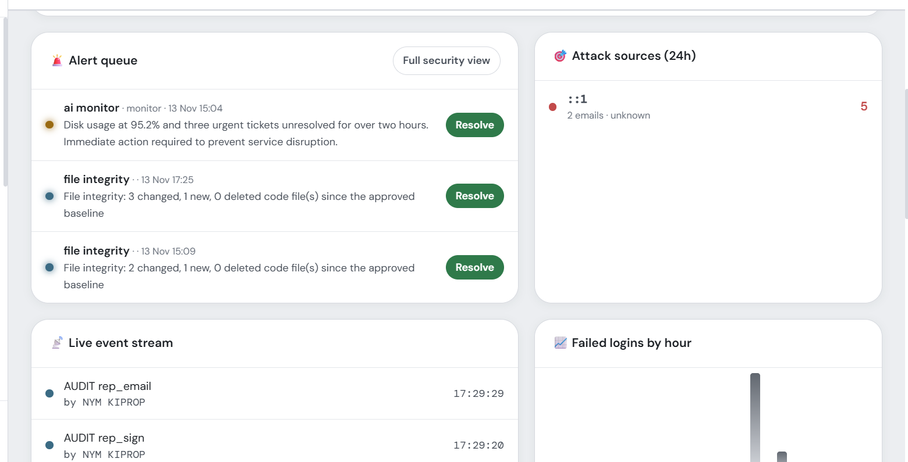

### AI Security Analyst

Runs automatically every 5-10 minutes (or on demand with **Run monitor now**). It reads the platform's signals, ranks the severity and returns findings plus suggested actions. In the example below it flagged disk usage at 95.2% and three high or critical tickets open for over two hours.

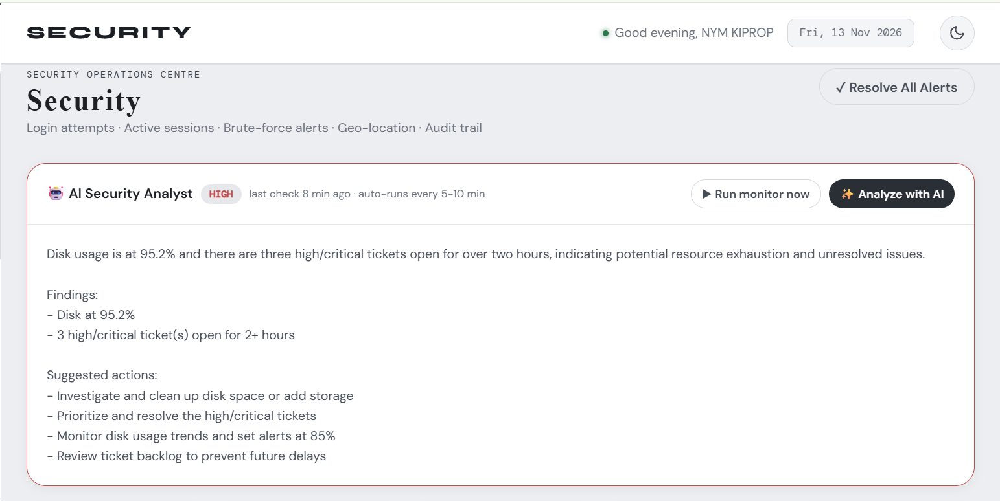

### AI-written PDF Security Reports

Pick a date range, tick "let the AI write the analysis" and generate. The PDF is built in **pure PHP with no libraries**, can be e-mailed, and supports **e-signing**. Each report includes a 0-100 risk score gauge, headline KPIs (login attempts, failed or blocked, alerts raised, IPs blocked, audit events, tests logged), an executive summary, key findings, charts and recommendations.

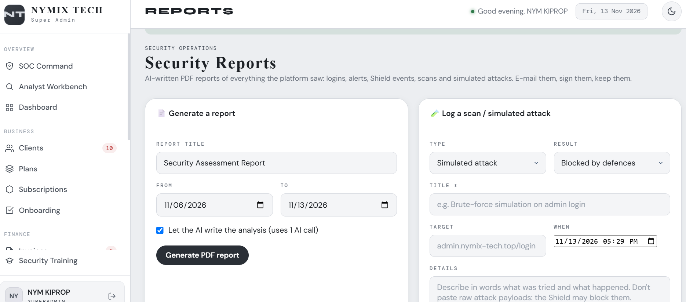

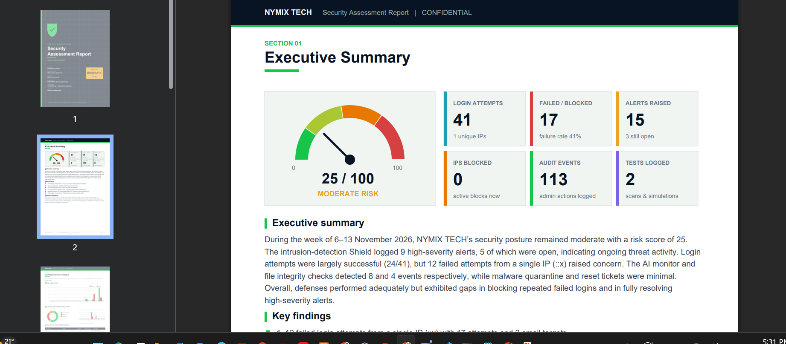

The first report for 6-13 November 2026 scored **25/100 (Moderate Risk)** and honestly pointed out gaps in how the platform handled repeated failed logins and resolving high-severity alerts. That is exactly what a report should do.

### Attack simulation

The **Log a scan / simulated attack** form records scans and simulated attacks so the AI folds them into the next report, and the Shield has a built-in safe simulator: it pushes a fake attacker through the **real** detection and auto-block pipeline using four probes (recon, scanner, SQL injection, path traversal), then reports whether the attacker was logged, scored or blocked. One click clears the simulation data afterwards. It is a way to test the defences without attacking anything real.

### NYMIX Shield (IDS / IPS)

`includes/nx_shield.php` is included at the top of every public entry file and inspects every request. It **fails open**: if anything inside the Shield breaks, the app keeps working.

On every request it:

1. Skips allow-listed IPs
2. Rejects blocked IPs with a 403 page
3. Inspects the URL, query string, form fields, JSON body and key headers for:
   - **Reconnaissance paths:** `/.env`, `.git`, `wp-login.php`, `phpmyadmin`, backups and dumps, webshells, `cgi-bin`
   - **Scanner tools:** sqlmap, nikto, nmap, masscan, acunetix, nessus, wpscan, gobuster, ffuf and more
   - **Injection:** SQL injection (UNION SELECT, boolean and time-based, `information_schema`, `INTO OUTFILE`), XSS, path traversal, file-inclusion wrappers (`php://`, `phar://` and others), command injection, **Log4Shell**, **Shellshock**, null bytes
   - **Abuse:** bad HTTP verbs, request floods and 404-burst directory brute forcing
4. Scores every hit and stores it as an event
5. **Auto-blocks** an IP when its 24-hour score reaches the threshold, with **escalating block times** (4x longer on each repeat, up to 7 days)
6. Raises a `security_alert`, which the alert mailer e-mails to the admins

Free-text fields (messages, notes, comments) are scanned with looser rules, and password, token and PIN fields are never inspected. On localhost the Shield logs and scores but never blocks, so you cannot lock yourself out while developing.

### Anti-malware and File Integrity Monitor

`includes/nx_malware.php`:

- **Upload scanning:** every file is checked before it is saved. Dangerous files in `uploads/` are **quarantined automatically**, with restore and purge actions
- **Signature scan** of your own PHP and JS code (alerts only, never auto-modifies code)
- **File Integrity Monitor (FIM):** compares code files against an **approved baseline** and flags new, changed or deleted files. This is what produces alerts like "3 changed, 1 new, 0 deleted code files since the approved baseline"
- Entropy analysis for obfuscated payloads
- Uses **Windows Defender or ClamAV** automatically when found, with built-in rules otherwise

### Security posture score

`includes/nx_posture.php` runs 30+ automatic checks and returns a **0-100 score, a letter grade and a prioritised fix list**. Categories:

| Category | Examples |
|---|---|
| Platform | PHP version, `display_errors`, `expose_php`, remote file inclusion disabled |
| Transport | HTTPS, security headers (CSP, X-Frame-Options, nosniff), CSP without `unsafe-inline`, HSTS |
| Sessions | HttpOnly and SameSite cookies, strict mode, session lifetime |
| Hardening | Database user is not root, `.htaccess` present, no dev files, setup files or database dumps left exposed, no stray zips, no placeholder secrets |
| Detection | Shield coverage on every entry file, brute-force lockout on admin login (5 failures per IP and 8 per account in 15 minutes) |
| Malware | Open malware findings, scan freshness, FIM baseline, antivirus engine, hash algorithm |
| Access | No stale or unverified admin accounts, two-factor authentication |
| Alerts | Unresolved alerts |

It is **localhost-aware**: checks that only matter on a live server (HTTPS, HSTS, secure cookies) show as "info" and do not hurt the score while developing, then become real checks the day the app goes live.

### SOC core

`includes/admin_soc.php` and `includes/admin_soc_alerts.php` provide: login-attempt logging with **geo-location**, device fingerprinting, **brute-force lockout**, session registration and forced logout, a full **audit trail**, role-based access control, the AI monitor, automatic reminders, error handlers that log fatal errors, and **email alerts** for high and critical findings.

### Scheduled jobs

| Job | Frequency | What it does |
|---|---|---|
| `admin/shield_cron.php` | every 5-15 min | Upload malware scan, code scan, integrity check, posture run, housekeeping |
| `admin/soc_watch.php` | every minute | AI watch and emailing of new alerts |
| `admin/cron_health.php` | every 5 min | System health snapshots |

---

## AI layer

| Feature | Files | What it does |
|---|---|---|
| **AI security analyst and monitor** | `includes/admin_soc.php` | Collects signals, applies rule-based findings, asks the AI to summarise and prioritise |
| **AI security reports** | `admin/report_engine.php` | Writes the narrative for the PDF reports |
| **AI help desk** | `includes/nx_support_ai.php`, `includes/nx_ai_engine.php`, `includes/support_console.php`, `admin/ai_autoreply.php` | Auto-replies to client tickets using real facts about the client's account |
| **AI onboarding** | `includes/onboarding_ai.php` | Verifies a new business, rejects disposable e-mail domains, creates the client, issues an access code and sends branded e-mails |
| **AI helpers for admins** | `admin/dashboard.php` | Daily brief, suggested ticket replies, broadcast drafting |
| **AI job scoring** | `includes/jobs_lib.php` | Scores applicants, with guards against **prompt injection** ("ignore previous instructions") and **discriminatory job ads** |

All AI calls go through a **provider fallback chain** (Groq, then Gemini, then OpenRouter) with **daily caps** to control cost.

---

## Payments and compliance

| Provider | Used for | Files |
|---|---|---|
| **M-Pesa (Daraja)** | STK push at the POS | `staff_portal.php` |
| **Paystack** | Card and mobile payments, signed receipt QR codes | `includes/paystack_helper.php`, `paystack_webhook.php` |
| **Pesapal** | Subscription payments with IPN handling | `pesapal_helper.php`, `pesapal_ipn.php` |
| **IntaSend** | Client portal checkout | `includes/intasend_helper.php` |
| **KRA eTIMS** | Tax-compliant sale submission queue with failure alerts | `staff_portal.php`, `etims_queue` table |

Receipts carry **signed QR codes** (`receipt.php`, `verify_receipt.php`) so they cannot be forged.

---

## Database

122 tables plus 5 reporting views, grouped by area. The schema is in [`database/schema.sql`](database/schema.sql) (structure only, no data).

| Area | Tables (examples) |
|---|---|
| **Platform and billing** | `clients`, `client_portal_users`, `branches`, `subscription_plans`, `subscriptions`, `subscription_payments`, `invoices`, `onboarding_requests` |
| **Sales and stock** | `products`, `categories`, `units`, `stock`, `stock_movements`, `stock_transfers`, `sales`, `sale_items`, `customers`, `customer_payments`, `etims_queue` |
| **Purchasing and finance** | `suppliers`, `supplier_payments`, `purchase_orders`, `purchase_items`, `expenses`, `expense_categories` |
| **People and payroll** | `users`, `roles`, `staff_attendance`, `staff_leave`, `staff_time_logs`, `staff_payroll`, `payslips`, `salary_allocations`, `salary_requests`, `salary_disbursements`, `hourly_payouts` |
| **Policies and reviews** | `company_policies`, `guidelines`, `guideline_signatures`, `account_reviews`, `account_review_log` |
| **Warehouse (WMS)** | `wh_warehouses`, `wh_zones`, `wh_locations`, `wh_grn`, `wh_batches`, `wh_transfers`, `wh_outbound_orders`, `wh_pick_items`, `wh_pack_slips`, `wh_stock_counts`, `wh_production_orders`, `wh_bom`, `wh_stock_ledger` |
| **Agrovet** | `ag_batches`, `ag_vet_pins`, `ag_restricted_sales`, `ag_farmer_profiles`, `ag_credit_promises`, `ag_preorders` |
| **Marketplace** | `mp_store_profiles`, `mp_listings`, `mp_orders`, `mp_order_items`, `mp_order_tracking`, `mp_reviews`, `mp_threads`, `mp_messages` |
| **Jobs** | `jb_jobs`, `jb_applications`, `jb_candidates`, `jb_blocks`, `jb_app_log` |
| **Messaging and support** | `msg_threads`, `msg_messages`, `support_tickets`, `ticket_replies`, `broadcast_queue`, `broadcast_log` |
| **Security and SOC** | `super_admins`, `admin_sessions`, `login_attempts`, `security_alerts`, `audit_log`, `admin_activity_log`, `nx_login_watch`, `nx_alert_state`, `nx_auto_log`, `error_log`, `system_health` |
| **AI** | `ai_insights`, `ai_usage`, `staff_ai_profiles` |

Reporting views: `v_soc_summary`, `v_failed_logins_24h`, `v_system_overview`, `v_monthly_revenue`, `v_client_subscriptions`, `v_expiring_soon`.

---

## Architecture

```
                    ┌──────────────────────────────────────────┐
                    │   Browser / installable PWA             │
                    └───────────────┬──────────────────────────┘
                                    │
                         ┌──────────▼──────────┐
                         │   NYMIX SHIELD      │  inspects every request,
                         │   (IDS / IPS)       │  scores, auto-blocks, fails open
                         └──────────┬──────────┘
        ┌──────────────┬────────────┼─────────────┬───────────────┐
        ▼              ▼            ▼             ▼               ▼
  Staff / POS      Client       Warehouse    Super Admin      Public receipt
    Portal         Portal        Portal        Portal         verification
        └──────────────┴────────────┼─────────────┴───────────────┘
                                    ▼
                  ┌─────────────────────────────────────┐
                  │  includes/  (shared engines)        │
                  │  payments · AI engines · onboarding │
                  │  malware + FIM · posture · SOC core │
                  └───────────────┬─────────────────────┘
                                  ▼
                       MySQL / MariaDB (122 tables)

  Cron:  shield_cron (scan, FIM, posture)  ·  soc_watch (AI watch, alert e-mail)  ·  cron_health
  AI:    Groq → Gemini → OpenRouter   (fallback chain with daily caps)
```

---

## Tech stack

| Layer | Technology |
|---|---|
| Backend | PHP 8.1+ (`mysqli` and PDO) |
| Database | MySQL / MariaDB |
| Frontend | Server-rendered PHP, Bootstrap, Chart.js, Font Awesome |
| PWA | `manifest.json`, `sw.js`, app icons |
| AI | Groq, Google Gemini, OpenRouter |
| Email | Brevo API (a legacy PHPMailer/Gmail path remains in a couple of files and is being phased out) |
| Payments | Daraja (M-Pesa), Paystack, Pesapal, IntaSend |
| Hosting | Apache with `.htaccess` hardening, cPanel cron or Windows Task Scheduler |
| PDF | Hand-written PHP PDF generator (no library) |

---

## Project structure

```
nymix-tech/
├── staff_portal.php            # Staff / POS portal
├── client_portal.php           # Client (business owner) portal
├── warehouse.php               # Warehouse portal (WMS)
├── identity_verify.php         # Kenyan ID verification (nothing stored)
├── receipt.php                 # Receipts with signed QR codes
├── verify_receipt.php          # Public receipt verification
├── paystack_webhook.php        # Paystack webhook and callback
├── pesapal_ipn.php             # Pesapal IPN handler
├── shield_404.php              # 404/403 handler that feeds the Shield
├── manifest.json · sw.js       # PWA
├── .htaccess                   # Apache hardening
├── admin/
│   ├── dashboard.php           # Super Admin portal
│   ├── shield_ui.php           # Shield interface
│   ├── shield_actions.php      # Shield actions (block, scan, simulate, FIM)
│   ├── report_engine.php       # AI security reports and PDF builder
│   ├── shield_cron.php         # Scheduled security sweep
│   ├── soc_watch.php           # AI watch (cron)
│   ├── cron_health.php         # Health snapshots (cron)
│   ├── subscriptions.php       # Subscriptions admin
│   └── setup.php               # One-time first-admin setup (locks itself)
├── includes/
│   ├── nx_shield.php           # IDS / IPS
│   ├── nx_malware.php          # Anti-malware + file integrity monitor
│   ├── nx_posture.php          # Security posture score
│   ├── admin_soc.php           # SOC core, RBAC, AI monitor
│   ├── admin_soc_alerts.php    # Alert e-mails
│   ├── nx_support_ai.php       # AI help desk
│   ├── nx_ai_engine.php        # AI auto-reply engine
│   ├── onboarding_ai.php       # AI onboarding
│   ├── jobs_lib.php            # Job board helpers
│   └── *_helper.php            # Paystack, Pesapal, IntaSend
├── database/schema.sql         # Schema only (no data)
├── assets/                     # Bootstrap, Chart.js, Font Awesome
├── docs/screenshots/           # 20 screenshots used in this README
├── uploads/ · logs/            # Runtime data (git-ignored)
└── *.example.php               # Config templates (copy and fill in)
```

---

## Getting started (local, XAMPP)

**Requirements:** PHP 8.1 or newer, MySQL or MariaDB, Apache (XAMPP works).

1. **Clone** into your web root (for example `C:\xampp\htdocs\nymix_hardwares`):
   ```bash
   git clone https://github.com/<your-username>/<repo-name>.git nymix_hardwares
   ```
2. **Create the database** and import the schema:
   ```bash
   mysql -u root -e "CREATE DATABASE nymix_hardware_management_system CHARACTER SET utf8mb4;"
   mysql -u root nymix_hardware_management_system < database/schema.sql
   ```
3. **Create your config files** from the templates and fill in your own keys:
   ```bash
   cp includes/db.example.php               includes/db.php
   cp includes/mail_config.example.php      includes/mail_config.php
   cp includes/paystack_config.example.php  includes/paystack_config.php
   cp includes/intasend_config.example.php  includes/intasend_config.php
   cp pesapal_config.example.php            pesapal_config.php
   ```
   In `includes/db.php`, set `$isLocal = true` and your local DB credentials (XAMPP default: user `root`, empty password).
4. **Legacy SMTP:** `admin/dashboard.php` and `warehouse.php` still contain an old PHPMailer/Gmail block with placeholder credentials. Admin email now goes through Brevo, so you can ignore or remove it. If you use it, install PHPMailer and add your own credentials.
5. **Super admin:** open `admin/setup.php`, set the secret string at the top of the file, and create your first super admin. The script locks itself once any admin exists.
6. **Cron jobs** (optional but recommended). On XAMPP use Windows Task Scheduler with `C:\xampp\php\php.exe`:
   ```
   */10 * * * *  php /path/to/admin/shield_cron.php
   * * * * *     php /path/to/admin/soc_watch.php
   */5 * * * *   php /path/to/admin/cron_health.php
   ```
7. **Apache:** the root `.htaccess` routes 404/403 to the Shield. If your folder is not named `nymix_hardwares`, edit the `ErrorDocument` paths.
8. **Try the SOC:** log in to the Super Admin portal, open **Shield**, and click the simulate action. Watch a fake attacker get detected, scored and blocked in real time.

---

## Security notes

- Real credentials live only in git-ignored config files. The repo ships `*.example.php` templates.
- `uploads/` (staff documents, signatures) and `logs/` are git-ignored and never committed.
- The Shield **fails open** by design, so a bug in the security layer can never take a business offline.
- Passwords, tokens and PINs are skipped by the Shield's inspector, so they never end up in event logs.
- Developer helper scripts (`diag.php`, `test_db.php`, `viewlog.php`, `debug.php`) are restricted to localhost by `.htaccess` and excluded from this repo.
- Found a vulnerability? Please open a private security advisory on GitHub instead of a public issue.

---

## What I learned

- **Building features is the easy part. Knowing when something is going wrong is the hard part.**
- AI is most useful in security when it **explains and prioritises**, not just when it raises alerts.
- Logging everything from day one makes every later feature easier.
- A good report is one that makes you uncomfortable enough to act. My first one scored 25/100 and showed real gaps in my own system.
- Detection that **fails open** keeps a small business online while you are still learning.
- Keeping it simple beats overengineering: a handful of well-chosen rules and checks catches a surprising amount.

---

## Roadmap

- [ ] Connect repeated failed logins to Shield IP blocking (today: lockout after 5 failures per IP and 8 per account, but no IP block)
- [ ] **Two-factor authentication** for admins (currently flagged by the posture check)
- [ ] Faster resolution workflow for high-severity alerts
- [ ] Move all hardcoded settings into config or environment files
- [ ] Retire the legacy PHPMailer/Gmail path
- [ ] Automated tests and CI

---

## Author

**Nym Kiprop**
Software developer · Founder of NYMIX TECH · Student at KCA University · Kenya

- LinkedIn: [linkedin.com/in/nym-kiprop-b5156a3a5](https://www.linkedin.com/in/nym-kiprop-b5156a3a5)

Feedback, ideas and security suggestions are welcome. If you work in security or SaaS, I'd love to hear what I should harden next.

---

<sub>© NYMIX TECH. All rights reserved. Add a `LICENSE` file if you want to open-source it.</sub>
